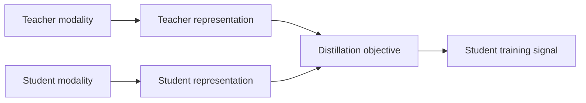

# Cross-Modal Knowledge Distillation: Research and Reproducibility Review

Research work carried out by Laura Cuenca during a university departmental collaboration. The goal was to understand how knowledge distillation can transfer information between modalities in computer vision and to assess how readily selected open-source research implementations could be reproduced.

**My contribution:** literature review, comparison of techniques, cloning repositories, and attempts to configure and run them. I did **not** implement the models, train new models, or produce benchmark results. The repositories reviewed belong to their original authors; their code is not included here.

## Questions explored

- What can a teacher model transfer to a student: final responses, intermediate features, or relationships between examples?
- What changes when teacher and student use different modalities, such as vision, audio, text, or sketches?
- Which practical details are needed to reproduce a research implementation: data, checkpoints, dependency versions, configuration files, and scripts?

## Reproducibility notes

| Project reviewed | Outcome during this study |
| --- | --- |
| [Acoustic Images Distillation](https://github.com/afperezm/acoustic-images-distillation) | Repository cloned; environment and input requirements were insufficiently documented for a reliable test. |
| [Xmodal-ViT](https://github.com/abhrac/xmodal-vit) | Repository cloned; setup and input requirements remained unclear. |
| [Speech2Video](https://github.com/michaelzhang-ai/Speech2Video) | The referenced repository could not be found at the time of the study. |
| [Text2Video](https://github.com/michaelzhang-ai/Text2Video) | Missing files or scripts prevented a complete test. |
| [MTDVocaLiST](https://github.com/xjchengit/mtdvocalist) | Missing files or scripts prevented a complete test. |

Across the attempts, dependency compatibility and incomplete setup instructions were recurring obstacles. This was a **reproducibility review**, not a comparison of model accuracy or speed.

## Technical synthesis

In cross-modal distillation, a teacher trained with one source of information guides a student that may use another. That creates design questions beyond ordinary model compression: how representations are aligned, whether paired data is available, how time is synchronized for video or audio, and whether the student can keep the useful signal when its input is less informative.

The review also considered possible applications in visual recognition and robotics. These are research directions discussed in the report, not implemented applications in this repository.

## What this work taught me

Research code is only useful to a new team when the execution path is explicit: compatible versions, available data and checkpoints, documented inputs, and an end-to-end example. The setup attempts made those requirements concrete and helped me distinguish an interesting paper from a result that I could independently verify.

The original documents contain academic contact information and third-party material, so this repository presents a concise, original account of my work instead of uploading the raw reports or copied repositories.
